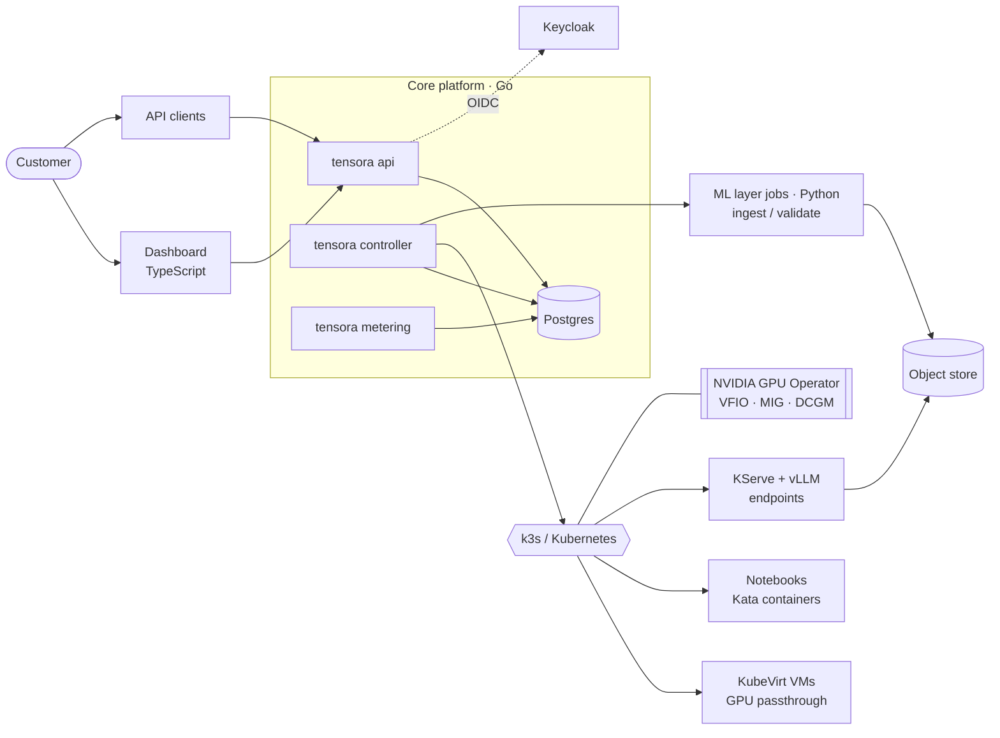

# Tensora

**A global GPU cloud for AI teams.** Rent GPUs by the second, run notebooks, or serve open
models through an OpenAI-compatible API, in the region you choose, with your data kept there.
Built for developers first, with an architecture ready for enterprise. The first region is India.
See the [product definition](docs/product/product-spec.md).

> "Tensora" is a working name. The final name is pending a trademark search.

Tensora assembles proven open-source infrastructure and adds the product layer on top:

- **Core platform (Go):** API, controller, and metering
- **ML layer (Python):** model ingestion and validation, benchmarking, GPU burn-in
- **Dashboard (TypeScript):** the web UI customers use

> **Status:** Phase 0, which covers decisions and scaffolding. See [docs/roadmap.md](docs/roadmap.md).

## Architecture at a glance



Details are in [docs/architecture/overview.md](docs/architecture/overview.md).

## Repository layout

```
controlplane/   Go: API, controller, metering (one `tensora` binary)
ml/             Python: model ingestion/validation, endpoint benchmarks, GPU burn-in
web/            TypeScript: customer dashboard
deploy/         helmfile for cluster add-ons, cluster-config chart, tensora chart
infra/          Ansible bootstrap for bare-metal GPU nodes
images/         Launch catalog and notebook/VM image definitions
docs/           Architecture, ADRs, runbooks, playbooks, hardware, roadmap
```

## Quickstart (no GPU required)

Prerequisites: Go 1.27+, [uv](https://docs.astral.sh/uv/), and Node 22+. Docker is only
needed for `make dev-pg`.

```bash
make setup      # install dev deps for all components
make dev        # API, controller, and metering in one process, with an in-memory store and fake cluster
make web-dev    # dashboard on http://localhost:5173 (in a second terminal)
```

Try the API as the seeded dev tenant `acme`:

```bash
curl -s localhost:8080/v1/catalog -H 'X-Dev-Tenant: acme' | jq
curl -s localhost:8080/v1/workloads -H 'X-Dev-Tenant: acme' -H 'Content-Type: application/json' \
  -d '{"name":"llm","kind":"endpoint","image_id":"vllm","gpu_class":"l40s-48gb","gpu_count":1,
       "model_uri":"hf://Qwen/Qwen2.5-0.5B-Instruct"}' | jq
curl -s localhost:8080/v1/workloads -H 'X-Dev-Tenant: acme' | jq   # pending → provisioning → running
```

## Bringing up real hardware

1. [docs/hardware/bill-of-materials.md](docs/hardware/bill-of-materials.md): choose the hardware
2. [docs/runbooks/01-node-bootstrap.md](docs/runbooks/01-node-bootstrap.md): BIOS, Ubuntu, Ansible, and k3s
3. [docs/runbooks/02-gpu-passthrough.md](docs/runbooks/02-gpu-passthrough.md): GPU Operator, KubeVirt, and the first GPU VM
4. [docs/runbooks/03-first-model-endpoint.md](docs/runbooks/03-first-model-endpoint.md): KServe and vLLM

## Working with AI agents

- [AGENTS.md](AGENTS.md) holds the canonical instructions for Codex and other agents.
- [CLAUDE.md](CLAUDE.md) imports AGENTS.md and adds Claude Code skills and subagents.
- Each component directory has its own `AGENTS.md` and `CLAUDE.md`.

## Docs

The [docs index](docs/README.md) links to the [roadmap](docs/roadmap.md), [ADRs](docs/adr/),
[runbooks](docs/runbooks/), [playbooks](docs/playbooks/), and the [glossary](docs/glossary.md).
