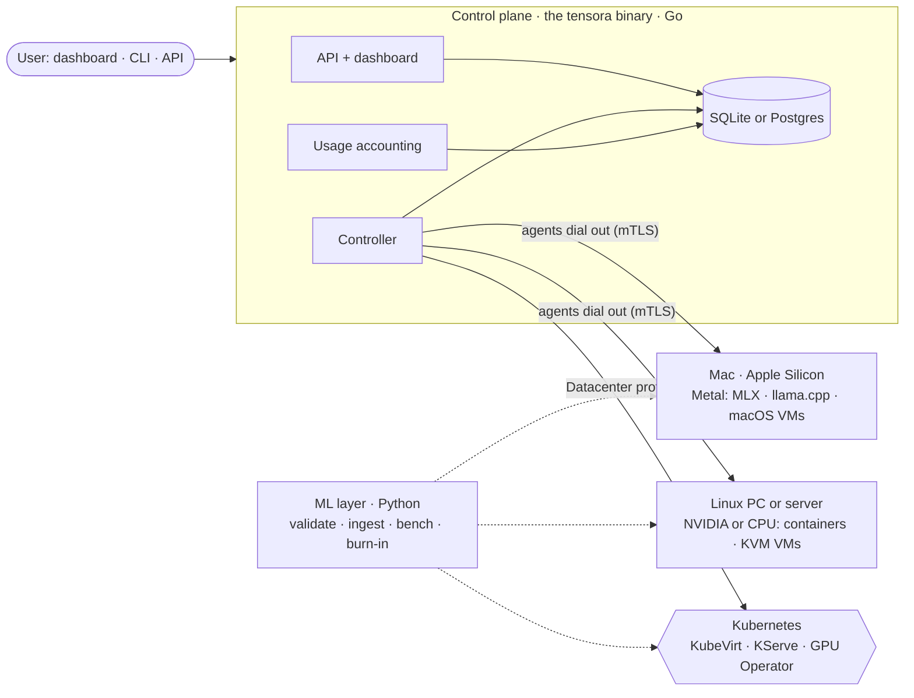

# Tensora

**A free, open GPU cloud you run yourself.** Install it on any machine you have, from a MacBook or
Mac Studio to a gaming PC or a rack of NVIDIA servers. Then launch **GPU VMs**, **Jupyter notebooks**,
and **OpenAI-compatible model endpoints** on it. Use it alone, share it with your team or class, or lend
idle machines to others. The same software runs from one laptop to a datacenter, **free for everyone**:
students, developers, startups, small companies, enterprises, and big tech.

> "Tensora" is a working name. The final name is pending a trademark search.
> See the [product definition](docs/product/product-spec.md) for the full picture.

## What you can run

| Workload | Mac (Apple Silicon) | Linux + NVIDIA | CPU-only machine |
|---|---|---|---|
| **GPU VM**: a full VM with root access over SSH | macOS VM with Metal | KVM with whole-GPU passthrough | Linux VM |
| **Notebook**: JupyterLab with a persistent workspace | PyTorch (MPS) and MLX on Metal | PyTorch with CUDA | PyTorch on CPU |
| **Model endpoint**: an OpenAI-compatible API | MLX or llama.cpp on Metal | vLLM or llama.cpp | llama.cpp (small models) |

If the GPU you want is busy, opt-in fallbacks run your workload on another GPU, on CPU, or on another machine.

## Three ways to deploy, one product

| Profile | For | Install |
|---|---|---|
| **Solo** | One person, one machine | One binary: `tensora up` (planned) |
| **Lab** | Classes, teams, home labs, small companies, with mixed Mac and Linux machines | `tensora up` on one machine and `tensora agent` on the rest (planned) |
| **Datacenter** | Startups at scale, enterprises, big tech | Kubernetes with KubeVirt, KServe, and the GPU Operator ([deploy/](deploy/), [infra/](infra/)) |

Every machine is **private by default**. Owners can share an idle machine with invited people, or with a
community pool, under strong host protections ([ADR-0014](docs/adr/0014-sharing-idle-compute.md)).

## Architecture at a glance



Details are in [docs/architecture/overview.md](docs/architecture/overview.md).

## Repository layout

```
controlplane/   Go: the tensora binary — API, controller, usage accounting, (planned) node agent, dashboard host
ml/             Python: model validation, ingestion, endpoint benchmarks, GPU burn-in
web/            TypeScript: the dashboard
deploy/         Datacenter profile: helmfile for cluster add-ons, cluster-config chart, tensora chart
infra/          Datacenter profile: Ansible bootstrap for Linux GPU servers
images/         Launch catalog and notebook/VM image definitions
docs/           Product spec, architecture, ADRs, roadmap, runbooks, playbooks, hardware
```

## Try it today (no GPU needed; runs on macOS and Linux)

Prerequisites: Go 1.27+, [uv](https://docs.astral.sh/uv/), and Node 22+.

```bash
make setup      # install dev dependencies for all components
make dev        # API, controller, and usage accounting in one process, with an in-memory store and a fake backend
make web-dev    # dashboard on http://localhost:5173 (in a second terminal)
```

```bash
curl -s localhost:8080/v1/catalog -H 'X-Dev-Tenant: acme' | jq
curl -s localhost:8080/v1/workloads -H 'X-Dev-Tenant: acme' -H 'Content-Type: application/json' \
  -d '{"name":"llm","kind":"endpoint","image_id":"vllm","gpu_class":"l40s-48gb","gpu_count":1,
       "model_uri":"hf://Qwen/Qwen2.5-0.5B-Instruct"}' | jq
curl -s localhost:8080/v1/workloads -H 'X-Dev-Tenant: acme' | jq   # pending → provisioning → running
```

`make build-all` cross-compiles the binary for macOS (Apple Silicon), Linux amd64, and Linux arm64.

## Status

| | Built | Planned |
|---|---|---|
| Control plane | API, lifecycle, quotas, controller, usage accounting, Postgres and in-memory stores, Kubernetes backend | SQLite store, node agent and drivers, `tensora up`, local accounts, regions, fallbacks, sharing |
| ML layer | Model validator (safetensors), ingestion, benchmarking, CUDA burn-in | GGUF validation, Metal burn-in |
| Dashboard | Workload list, launch form | Machines, sharing, usage reports, embedded in the binary |
| Datacenter | Charts, add-ons, Ansible, runbooks (rendered and linted, not yet run on hardware) | Production validation |

The full plan is in the [roadmap](docs/roadmap.md). Your Mac is enough hardware for Phases 1–2.

## Docs

- [Product definition](docs/product/product-spec.md)
- [Roadmap](docs/roadmap.md)
- [Architecture](docs/architecture/overview.md)
- [Decisions (ADRs)](docs/adr/README.md)
- [Runbooks](docs/runbooks/README.md)
- [Playbooks](docs/playbooks/)
- [Glossary](docs/glossary.md)

## Working with AI agents

- [AGENTS.md](AGENTS.md) holds the canonical instructions for Codex and other agents.
- [CLAUDE.md](CLAUDE.md) imports AGENTS.md and adds Claude Code skills and subagents.
- Each component directory has its own `AGENTS.md` and `CLAUDE.md`.

## Licence

Open source and free for everyone ([ADR-0011](docs/adr/0011-free-for-everyone.md)). The licence is
still to be chosen (Apache-2.0 is recommended); see the roadmap.
