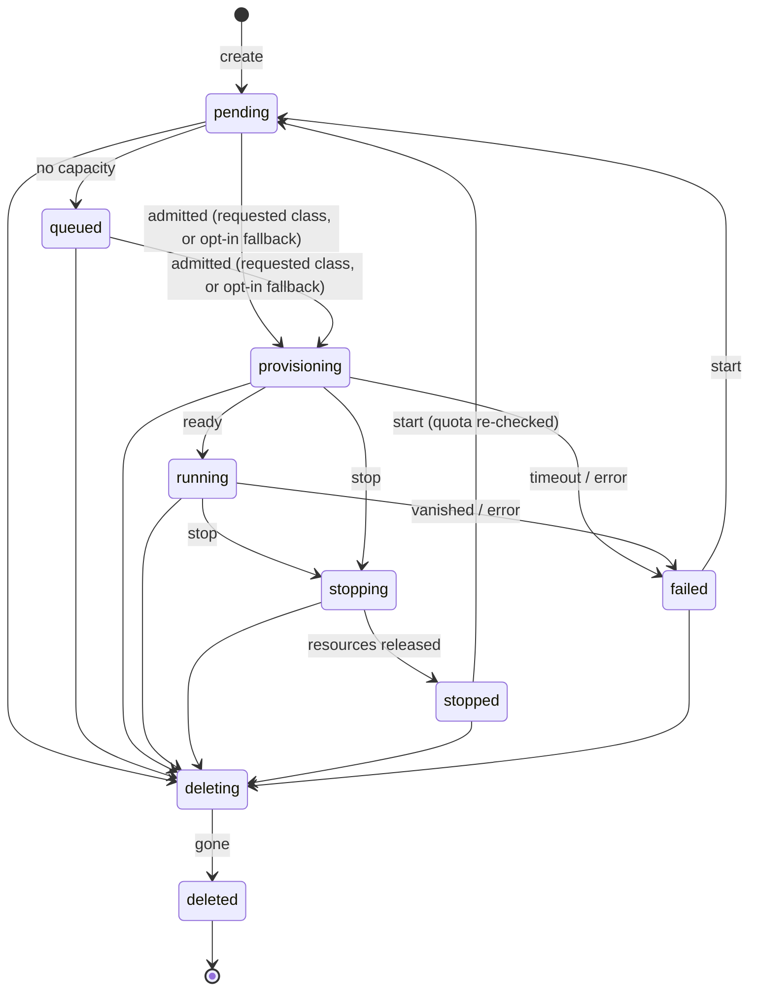

# Control plane

One Go binary (`controlplane/`), `tensora`, whose subcommand picks the role.

| Command | Role | Used in | Status |
|---|---|---|---|
| `tensora up` | API, controller, usage accounting, in-process agent, and dashboard in one process, using SQLite | Solo | Planned (Phase 1) |
| `tensora api` | Authn/z, validation, quota checks, recording intent | Lab, Datacenter | Built |
| `tensora controller` | Admission, placement, applying and observing workloads through a backend, lifecycle transitions | Lab; Datacenter (one per region) | Built (fake and Kubernetes backends) |
| `tensora metering` | Usage accounting: turns lifecycle events into hourly usage records (no money, ADR-0011) | Lab, Datacenter | Built |
| `tensora agent` | Node agent on each machine; runs workloads through OS drivers (ADR-0013) | Lab | Planned (Phase 1–2) |
| `tensora migrate` | Applies the embedded SQL migrations | Lab (Postgres), Datacenter | Built |
| `tensora dev` | Development all-in-one: in-memory store (or SQLite or Postgres via `TENSORA_DATABASE_URL`), fake backend, seeded users | Development | Built; runs on macOS and Linux |
| `tensora workloads [-all]`, `events <id>`, `export <id>` | CLI client for a running API: list, full timeline, complete log export ([logs](logs-and-transparency.md)) | Every profile | Built (launch, stop, and `logs --follow` planned) |

## Sources of truth ([ADR-0008](../adr/0008-postgres-intent-kubernetes-runtime.md), [ADR-0012](../adr/0012-deployment-profiles.md))

- **The store** owns business state: tenants, quotas, machines, workload intent, the event history, and usage. It's SQLite in Solo and small Labs, and Postgres otherwise.
- **The runtime** owns runtime state: node agents in Solo and Lab, Kubernetes in a datacenter.
- The **controller** reconciles the two. The API never talks to the runtime. It records intent and returns immediately.

## Backends (AGENTS.md rule 2)

All runtime access goes through `cluster.Backend`:

| Backend | Talks to | Status |
|---|---|---|
| `fake` | Nothing (in memory) | Built; used by `tensora dev` and tests |
| `kubernetes` | A Kubernetes cluster, through server-side apply and an allowlist of kinds | Built |
| `agent` | Node agents, which dial out to the control plane over mTLS | Planned ([ADR-0013](../adr/0013-node-agent-and-apple-silicon.md)) |

## Workload lifecycle

Source: `controlplane/internal/domain/state.go`. Keep this diagram in sync with it.

*Planned (ADR-0014):* a `preempted` state, for workloads stopped because a shared machine's owner reclaimed it.

| Property | States | Used by |
|---|---|---|
| `HoldsQuota` | pending, queued, provisioning, running, stopping | Quota check in the API |
| `HoldsCapacity` | provisioning, running, stopping, deleting | Admission in the controller |
| `Metered` | running | Usage accounting |

Every transition goes through `service.Transition`. It validates the step, compare-and-swaps the row,
and appends a `workload_events` row. If the API and the controller race, one CAS fails and that side retries next pass.

Each row carries a specific, human-readable reason, which becomes the workload's **timeline** (rule 14).
Decisions that don't change state, such as retrying after the runtime refused an action, are **notes**: rows
whose `from` equals `to`, written by `service.Note` and ignored by usage accounting. Reasons come from a fixed
vocabulary, never from raw runtime messages, and `service.CleanReason` cleans every reason before it's stored
([logs and transparency](logs-and-transparency.md#what-the-timeline-says)):

| Transition | Example reason |
|---|---|
| create | `created by dev@acme`, or with local accounts `created by you@example.com (API token "laptop" (tsk_Ab3x…))` |
| user action | `stop requested by you@example.com (browser session)` |
| queued (trusted tenant) | `waiting for l40s-48gb capacity: requested 2 GPU(s), 0 free` |
| queued (untrusted tenant) | `waiting for l40s-48gb capacity: requested 2 GPU(s), not enough free right now` |
| admitted | `admitted: 2 × l40s-48gb`, or for an endpoint `admitted: 1 × l40s-48gb, served by vllm` |
| retrying (note) | `couldn't start it on the runtime; retrying. The operator's log has the details under this workload's ID.` |
| runtime unreachable (note) | `couldn't read its status from the runtime; retrying. …`, `couldn't check for free GPUs on the runtime; retrying. …` |
| failure | A fixed reason from the backend (`model server not ready (RevisionFailed)`), the timeout, or `can't start: GPU class "x" is no longer offered by this installation` |

## Admission and placement

- **Quota** (API, at create and start): GPUs held plus the request must not exceed the tenant's quota for that class. The quota row is locked, so concurrent creates serialize.
- **Capacity** (controller): schedulable capacity per class, minus what the store says is allocated.
- **Order:** FIFO with backfill. *Known gap:* large requests can starve, so aging is planned.
- *Planned:* **region** (ADR-0009), **fallbacks** (ADR-0010), **sharing levels and the trust matrix** (ADR-0014, which decides which machines a user's workload may land on), and **fair share** from usage accounting.
- **Backstop:** in the Datacenter profile, each tenant namespace also has a GPU `ResourceQuota`.

## Reconcile loop

`Controller.ReconcileOnce` runs every `TENSORA_CONTROLLER_INTERVAL`:

| Step | Picks up | Does |
|---|---|---|
| admit | pending, queued | Capacity check; apply the workload through the backend; go to `provisioning`, or `queued` if there's no room |
| observe | provisioning, running | Ready means `running`. A failure, vanished objects, or a provisioning timeout releases resources and goes to `failed`. |
| park | stopping | Halt the VM, scale the notebook to 0, or remove the endpoint. Go to `stopped` once observed. |
| remove | deleting | Delete everything belonging to the workload, including volumes, then go to `deleted`. |

## What each kind becomes

**Datacenter** (built, in the tenant namespace `t-<slug>`):

| Kind | Objects | Stopped form |
|---|---|---|
| vm | `VirtualMachine`, with its root disk cloned from a DataSource | `runStrategy: Halted`, disk kept |
| notebook | `StatefulSet` + `Service`, with a 50Gi PVC | `replicas: 0`, PVC kept |
| endpoint | `InferenceService` using the `tensora-vllm` runtime | Deleted |

Every tenant also gets a namespace bundle: PSA baseline, a GPU `ResourceQuota`, a default-deny NetworkPolicy, Gateway ingress, and image-clone RBAC.

**Agents** (planned, ADR-0013):

| Kind | Mac | Linux |
|---|---|---|
| vm | macOS guest (`macos-vz`, Metal) or Linux guest (CPU) | KVM guest (`libvirt`, VFIO GPU) |
| notebook | Native Jupyter in a sandbox (`macos-native`, Metal), or a Linux container in its own VM (`macos-container`, CPU) | Container (`docker`, CUDA or CPU) |
| endpoint | MLX or llama.cpp server (`macos-native`, Metal) | vLLM or llama.cpp (`docker`) |

## API conventions

- Versioned under `/v1`. JSON only, and unknown fields are rejected.
- Errors look like `{"error": {"code", "message", "request_id"}}`. The codes are `invalid_request` (400), `unauthenticated` (401), `forbidden` (403), `not_found` (404), and `conflict`, `quota_exceeded`, `invalid_transition` (409).
- Every response carries `X-Request-ID`, which the server always generates. The ID is on every log line for that request, along with the tenant and subject once the request is authenticated. A caller's own `X-Request-ID` is logged as `client_request_id` if it's safe (`[A-Za-z0-9._-]`, at most 64 characters), and dropped otherwise.
- `GET /v1/workloads` and `GET /v1/workloads/{id}` take `include_deleted=true` to include deleted workloads, whose history stays available.
- Unexpected errors return **500** with a generic message and the request ID. The full error goes only to the operator's log.
- Async actions return **202** and the current state.
- Another tenant's object is always **404**.
- IDs are UUIDv7. Runtime object names derive from IDs, never from user input.
- Workload responses include `region` and, once admitted, `placed_class`. `gpu_class` is the class requested; the two differ only after an opt-in fallback.
- Create takes an optional `region`, checked against the catalog's regions (the first is the default). The class must be offered there, and the image must have a runtime for the class's accelerator.
- *Planned:*
  - Create takes `fallback` and `fallback_after`.
  - Responses include `machine` once agents place workloads on machines.
  - `POST` accepts `Idempotency-Key` (the `idempotency_keys` table exists), and every 503 carries `Retry-After`.

## Failure modes

| Failure | Effect | Notes |
|---|---|---|
| Controller down | New work stays `pending`; running workloads are unaffected | A workload that dies meanwhile stays `running` in the records until the controller returns. Usage accounting corrects for it later (Phase 3). |
| Store down | API not ready (503); the controller pauses; workloads keep running | |
| Runtime unreachable (Kubernetes API, or an agent) | Admission and observation stop for that runtime | Each affected workload gets one note in its timeline (`couldn't check for free GPUs`, `couldn't read its status`). A provisioning workload still fails at the provisioning timeout. |
| A GPU class or image removed from the catalog | Waiting workloads fail with `can't start: … is no longer offered by this installation` | *Known gap:* a running or stopping workload of that class can't be parked, because releasing it rebuilds its objects from the catalog. Its timeline says so, and the operator has to restore the entry. Planned: release from what the runtime already has. |
| Agent offline (laptop closed, machine asleep) | Its workloads become unavailable, and go to `failed` after a grace period | Planned (Phase 2) |
| Node or machine lost | Its workloads go to `failed` | |
| One region down | Only that region is affected | ADR-0009 |
| GPU busy | `queued`, or placed on an opted-in fallback | ADR-0010 |
| Owner reclaims a shared machine | Guest workloads are preempted, then re-queued if the user opted in | ADR-0014 (planned) |

## Regions and fallback placement

*Built:* every workload, machine, and usage record has a `region`; create takes one; each controller reconciles one region (`TENSORA_REGION`) and never sees, counts, or admits another's workloads. Workloads record `placed_class` and `machine_id` at admission, in the same transaction as the move to provisioning; capacity is counted per region by placed class (or by requested class for a workload holding GPUs without a recorded placement, so it's never under-counted), and usage is accounted by placed class. A machine hosts only workloads in its own region, and only its owner's unless it's in a community pool (`Machine.CanHost`). *Planned:* fallback placement (roadmap).

- **Regions** ([ADR-0009](../adr/0009-regions-global-control-plane-regional-cells.md)): every workload gets an immutable `region`, and Solo has one region, `local`. In a datacenter, one controller runs per region (`TENSORA_REGION`).
- **Fallback placement** ([ADR-0010](../adr/0010-fallbacks-cpu-placement-and-inference-failover.md)): `fallback` is an ordered list of other classes or `cpu`, tried after `fallback_after`. The workload records the requested class (`gpu_class`) and `placed_class`. Freed GPUs go to requested-class waiters first. Placement happens in one place, the controller's `place` step.
- **Inference failover** happens per request in the inference gateway, not in the controller.

## Next resources

- **Machines** (agents): enrolment, inventory, health, sharing level (Phases 1–2, 4). The `machines` table and its store methods exist; nothing creates machines yet.
- **Users, teams, invites**: local accounts and quotas (Phase 2)
- **Models:** `tensora-ml ingest` validates, then caches per machine or region (Phases 2–3)
- **Access:** a relay through the control plane to notebooks, endpoints, and VM SSH (Phase 2)
- **Usage API:** `GET /v1/usage`, for reports and fairness, never money (Phase 2)
- **Logs** ([ADR-0015](../adr/0015-logs-and-transparency.md)): `GET /v1/workloads/{id}/logs` for workload output (Phase 1), and the per-tenant activity log (Phase 2)
- **Operations:** `/metrics`, admission aging, leader election (Phase 3)
