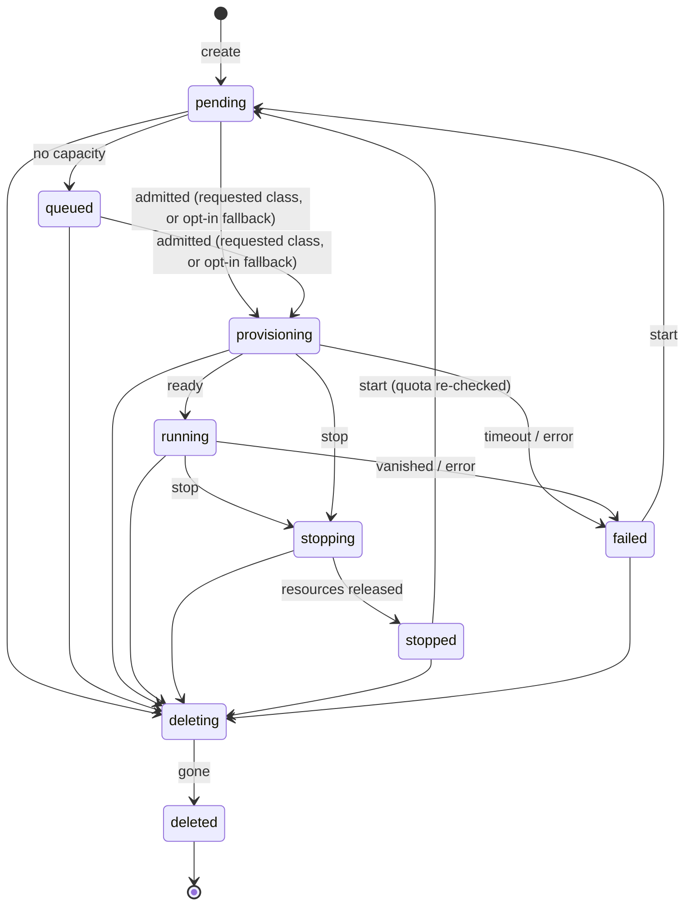

# Control plane

One Go binary (`controlplane/`), `tensora`, whose subcommand picks the role.

| Command | Role | Used in | Status |
|---|---|---|---|
| `tensora up` | API, controller, usage accounting, in-process agent, and dashboard in one process, using SQLite | Solo | Planned (Phase 1) |
| `tensora api` | Authn/z, validation, quota checks, recording intent | Lab, Datacenter | Built |
| `tensora controller` | Admission, placement, running and observing workloads through a backend, lifecycle transitions; with the agent backend, also this machine's in-process agent | Lab; Datacenter (one per region) | Built (fake, Kubernetes, and agent backends) |
| `tensora metering` | Usage accounting: turns lifecycle events into hourly usage records (no money, ADR-0011) | Lab, Datacenter | Built |
| `tensora agent` | Node agent on other machines, joining over the network (ADR-0013, ADR-0016) | Lab | Planned (Phase 2). The agent itself is built and runs in-process (below). |
| `tensora migrate` | Applies the embedded SQL migrations | Lab (Postgres), Datacenter | Built |
| `tensora dev` | Development all-in-one: in-memory store (or SQLite or Postgres via `TENSORA_DATABASE_URL`), fake backend (or the agent backend with `TENSORA_CLUSTER_BACKEND=agent`), seeded users | Development | Built; runs on macOS and Linux |
| `tensora workloads [-all]`, `events <id>`, `export <id>` | CLI client for a running API: list, full timeline, complete log export ([logs](logs-and-transparency.md)) | Every profile | Built (launch, stop, and `logs --follow` planned) |

## Sources of truth ([ADR-0008](../adr/0008-postgres-intent-kubernetes-runtime.md), [ADR-0012](../adr/0012-deployment-profiles.md))

- **The store** owns business state: tenants, quotas, machines, workload intent, the event history, and usage. It's SQLite in Solo and small Labs, and Postgres otherwise.
- **The runtime** owns runtime state: node agents in Solo and Lab, Kubernetes in a datacenter.
- The **controller** reconciles the two. The API never talks to the runtime. It records intent and returns immediately.

## Backends (AGENTS.md rule 2)

All runtime access goes through `cluster.Backend`, which is runtime-neutral ([ADR-0016](../adr/0016-agent-protocol-and-machine-placement.md)):
`Capacity`, `Run(spec)`, `Park(spec)`, `Observe(ref)`, and `Delete(ref)`. A spec is the placed workload with its
class, image, and runtime, and on agents its machine and driver; each backend turns it into what its runtime needs.

| Backend | Talks to | Capacity | Status |
|---|---|---|---|
| `fake` | Nothing (in memory) | Units per class (`TENSORA_FAKE_CAPACITY`) | Built; used by `tensora dev` and tests |
| `kubernetes` | A Kubernetes cluster, through server-side apply and an allowlist of kinds; builds manifests from specs | Units per class over Ready nodes; Kubernetes picks the node | Built |
| `agent` (`internal/cluster/agents`) | Node agents, which sync with it (below) | The machines connected now: devices per class, usable CPUs and memory, drivers; the controller picks the machine | Built, with the in-process agent (Solo). Agents joining over the network: Phase 2. |

**Agents** ([ADR-0016](../adr/0016-agent-protocol-and-machine-placement.md)) make one call, `Sync`. The agent sends
the status of every workload it has (as codes from a fixed vocabulary) and its inventory when it changes. The
backend answers with the machine's complete desired state as soon as that changes, or after 20 seconds (a long
poll). Desired state is computed from the store on every sync, so a restart never makes an agent stop or delete
anything:

- provisioning or running: run;
- deleting, or a stopped endpoint: remove, with everything it stored;
- anything else: parked, keeping its disk.

`Run`, `Park`, and `Delete` only wake the machine's agent. A machine that hasn't synced for 45 seconds is offline:
it isn't offered for placement, and its workloads' status reads as unknown. In Solo the agent runs in the
controller's process, on this machine, owned by the tenant `TENSORA_MACHINE_OWNER`. Over the network (Phase 2) the
same call is `POST /agent/v1/sync` over HTTPS with mutual TLS.

## Workload lifecycle

Source: `controlplane/internal/domain/state.go`. Keep this diagram in sync with it.

*Planned (ADR-0014):* a `preempted` state, for workloads stopped because a shared machine's owner reclaimed it.

| Property | States | Used by |
|---|---|---|
| `HoldsQuota` | pending, queued, provisioning, running, stopping | Quota check in the API |
| `HoldsCapacity` | provisioning, running, stopping, deleting | Admission in the controller |
| `Metered` | running | Usage accounting |

Every transition goes through `service.Transition`. It validates the step, compare-and-swaps the row,
and appends a `workload_events` row. If the API and the controller race, one CAS fails and that side retries next pass.

Each row carries a specific, human-readable reason, which becomes the workload's **timeline** (rule 14).
Decisions that don't change state, such as retrying after the runtime refused an action, are **notes**: rows
whose `from` equals `to`, written by `service.Note` and ignored by usage accounting. Reasons come from a fixed
vocabulary, never from raw runtime messages, and `service.CleanReason` cleans every reason before it's stored
([logs and transparency](logs-and-transparency.md#what-the-timeline-says)):

| Transition | Example reason |
|---|---|
| create | `created by dev@acme`, or with local accounts `created by you@example.com (API token "laptop" (tsk_Ab3x…))` |
| user action | `stop requested by you@example.com (browser session)` |
| queued (trusted tenant) | `waiting for l40s-48gb capacity: requested 2 GPU(s), 0 free` |
| queued (untrusted tenant) | `waiting for l40s-48gb capacity: requested 2 GPU(s), not enough free right now` |
| admitted | `admitted: 2 × l40s-48gb`, for an endpoint `admitted: 1 × l40s-48gb, served by vllm`, and on agents `admitted: 1 × apple-silicon-32gb on studio with macos-native` |
| queued (no machine) | `waiting for a machine that can run apple-silicon-32gb to come online`, or `waiting for its machine to come online: its disk is there` |
| machine offline (note) | `its machine is offline; waiting for it to reconnect` |
| what an agent reports | A fixed reason per code: `starting on its machine`, `waiting for its machine's GPU to be free`, `it ran out of memory`, and so on; an unknown code reads `its machine reported a problem` |
| retrying (note) | `couldn't start it on the runtime; retrying. The operator's log has the details under this workload's ID.` |
| runtime unreachable (note) | `couldn't read its status from the runtime; retrying. …`, `couldn't check for free GPUs on the runtime; retrying. …` |
| failure | A fixed reason from the backend (`model server not ready (RevisionFailed)`), the timeout, or `can't start: GPU class "x" is no longer offered by this installation` |

## Admission and placement

- **Quota** (API, at create and start): GPUs held plus the request must not exceed the tenant's quota for that class. The quota row is locked, so concurrent creates serialize.
- **Capacity** (controller): what the backend reports, minus what the store says is held.
- **Placement** (controller, `internal/controller/placement.go`, the one place it's decided): on a cluster, the requested class. On agents, a machine and a driver:
  - the machine is the tenant's own, until sharing lets a user choose another's (Phase 4), and it's in the workload's region (`Machine.CanHost`);
  - the driver runs the workload's kind on the class's accelerator, and **weak isolation** (`macos-native`, plain `docker`, `sim`) is only for the machine owner's own workloads (`Machine.Permits`, the trust matrix). A driver's isolation comes from `domain.LookupDriver`, never from what an agent reports;
  - the class's devices, CPUs, and memory are free on the machine. An NVIDIA or AMD device matches the class listing its model (catalog `models`); a Mac's GPU matches the largest Apple class its unified memory holds;
  - a VM or notebook that has run before goes back to the machine holding its disk, with the driver holding its data, and waits for them;
  - a driver's per-machine limit holds (`macos-vz`: two macOS VMs per Mac).
- **Agents check too:** an agent refuses a driver it doesn't have, weak isolation for a workload that needs strong, a notebook or VM asked to move to another driver, and starting a workload while any other is still active on the GPU it needs. It deletes data only for a workload listed for removal; one it wasn't told about is stopped and kept.
- **Attempts:** each admission is a new attempt (`workloads.attempt`). An agent starts an attempt at most once, so a workload that failed or stopped by itself isn't restarted until it's started again, and drivers report which attempt a status is about. A workload still running another attempt is stopped first (keeping its data), and its GPU counts as taken until it has; attempts are compared for equality, so a restored database's lower count still runs. A status answers the controller only for the attempt and mode (run, park, or remove) the store expects, and only once the agent has applied them; before that, even no status at all reads as still in progress.
- **Machine identity:** the in-process agent's machine is found by the ID saved in `machine-id` next to the SQLite database (or in `TENSORA_AGENT_STATE_DIR`), never by hostname, so renaming the Mac changes only its label. Its owner and region never change.
- **After a restart**, the agent backend reports that it's settling until every machine in its region has reconnected (at most 45 seconds), and the controller admits nothing meanwhile. An unknown status decides nothing, not even the provisioning timeout; a machine that stays away is reported failed after 10 minutes.
- **The agent backend runs with SQLite** (Solo) until agents join over the network (Phase 2): with Postgres, controllers on several hosts could share a region while each sees only its own machine.
- **Agents keep syncing while they work:** applying runs beside the sync loop, and each driver call has a time limit, so a long image pull never makes a busy machine look offline. Anything worth reporting (a desired state applied, a workload's status changing, checked every 2 seconds) cuts the waiting sync short, so the controller hears it at once rather than when the long poll ends. A report that doesn't fit the machine is refused: the machine isn't offered for placement until a good one arrives, but it still gets its desired state.
- **Order:** FIFO with backfill. *Known gap:* large requests can starve, so aging is planned.
- *Planned:* **fallbacks** (ADR-0010), **invite lists** (ADR-0014; an invite-only machine counts as private until then), and **fair share** from usage accounting.
- **Backstop:** in the Datacenter profile, each tenant namespace also has a GPU `ResourceQuota`.

## Reconcile loop

`Controller.ReconcileOnce` runs every `TENSORA_CONTROLLER_INTERVAL`:

| Step | Picks up | Does |
|---|---|---|
| admit | pending, queued | Place it (above) and go to `provisioning` in one transaction, then `Run` it; or go to `queued`, with the reason, if there's no room |
| observe | provisioning, running | Ready means `running`. Provisioning but absent from the runtime: `Run` again (it's idempotent). A failure, a workload that vanished, or a provisioning timeout releases resources and goes to `failed`. An unknown status (machine offline or reconnecting) is noted and decides nothing, not even the provisioning timeout; the agent backend reports a machine away for 10 minutes as failed. |
| park | stopping | Halt the VM, scale the notebook to 0, or remove the endpoint. Go to `stopped` once observed. |
| remove | deleting | Delete everything belonging to the workload, including volumes, then go to `deleted`. |

## What each kind becomes

**Datacenter** (built, in the tenant namespace `t-<slug>`):

| Kind | Objects | Stopped form |
|---|---|---|
| vm | `VirtualMachine`, with its root disk cloned from a DataSource | `runStrategy: Halted`, disk kept |
| notebook | `StatefulSet` + `Service`, with a 50Gi PVC | `replicas: 0`, PVC kept |
| endpoint | `InferenceService` using the `tensora-vllm` runtime | Deleted |

Every tenant also gets a namespace bundle: PSA baseline, a GPU `ResourceQuota`, a default-deny NetworkPolicy, Gateway ingress, and image-clone RBAC.

**Agents** (ADR-0013; the drivers are roadmap step 7, except `sim`, which runs nothing and is for development only):

| Kind | Mac | Linux |
|---|---|---|
| vm | macOS guest (`macos-vz`, Metal) or Linux guest (CPU) | KVM guest (`libvirt`, VFIO GPU) |
| notebook | Native Jupyter in a sandbox (`macos-native`, Metal), or a Linux container in its own VM (`macos-container`, CPU) | Container (`docker`, CUDA or CPU) |
| endpoint | MLX or llama.cpp server (`macos-native`, Metal) | vLLM or llama.cpp (`docker`) |

## API conventions

- Versioned under `/v1`. JSON only, and unknown fields are rejected.
- Errors look like `{"error": {"code", "message", "request_id"}}`. The codes are `invalid_request` (400), `unauthenticated` (401), `forbidden` (403), `not_found` (404), and `conflict`, `quota_exceeded`, `invalid_transition` (409).
- Every response carries `X-Request-ID`, which the server always generates. The ID is on every log line for that request, along with the tenant and subject once the request is authenticated. A caller's own `X-Request-ID` is logged as `client_request_id` if it's safe (`[A-Za-z0-9._-]`, at most 64 characters), and dropped otherwise.
- `GET /v1/workloads` and `GET /v1/workloads/{id}` take `include_deleted=true` to include deleted workloads, whose history stays available.
- Unexpected errors return **500** with a generic message and the request ID. The full error goes only to the operator's log.
- Async actions return **202** and the current state.
- Another tenant's object is always **404**.
- IDs are UUIDv7. Runtime object names derive from IDs, never from user input.
- Workload responses include `region` and, once admitted, `placed_class`, and on agents `machine_id` and `driver`. `gpu_class` is the class requested; the two differ only after an opt-in fallback.
- Create takes an optional `region`, checked against the catalog's regions (the first is the default). The class must be offered there, and the image must have a runtime for the class's accelerator.
- *Planned:*
  - Create takes `fallback` and `fallback_after`.
  - A `/v1/machines` resource with machine names (roadmap step 9).
  - `POST` accepts `Idempotency-Key` (the `idempotency_keys` table exists), and every 503 carries `Retry-After`.

## Failure modes

| Failure | Effect | Notes |
|---|---|---|
| Two controllers for one region | Only one reconciles: each takes the lease `controller:<region>` in the store (three intervals, at least 30 seconds), and another stands by until it's free. The leader renews it in the background every third of that time, so a long pass never lets it lapse; if another holds it, or renewing fails for two thirds of its time, the leader cancels what it's doing and stops, so its supervisor restarts it as a standby. A clean stop releases the lease once the in-process agent has stopped too, so a standby takes over at once. With the agent backend, the in-process agent runs only in the leader, an OS lock on its state directory keeps it to one agent per machine whatever the timing, and machines get their reconnect window from when the leader starts leading. Leases use each controller's clock, so controllers sharing Postgres need synchronized clocks (chrony). | Built |
| Controller down | New work stays `pending`; running workloads are unaffected | A workload that dies meanwhile stays `running` in the records until the controller returns. Usage accounting corrects for it later (Phase 3). |
| Store down | API not ready (503); the controller pauses; workloads keep running | |
| Runtime unreachable (the Kubernetes API; for agents, see "Agent offline") | Admission and observation stop for that runtime | Each affected workload gets one note in its timeline (`couldn't check for free GPUs`, `couldn't read its status`). A provisioning workload still fails at the provisioning timeout. |
| A GPU class or image removed from the catalog | Waiting workloads fail with `can't start: … is no longer offered by this installation` | *Known gap:* a running or stopping workload of that class can't be parked, because releasing it rebuilds its objects from the catalog. Its timeline says so, and the operator has to restore the entry. Planned: release from what the runtime already has. |
| Agent offline (laptop closed, machine asleep) | It isn't offered for placement. Its workloads' status reads as unknown, noted once in their timelines (`its machine is offline; waiting for it to reconnect`). After 10 minutes offline, a provisioning or running workload fails (`its machine has been offline for over 10m0s`) and a stopping one is stopped, so neither stays accounted or holds quota; the machine stops them when it returns. VMs and notebooks that ran there wait for it (`waiting for its machine to come online: its disk is there`). | Built |
| A running workload stops by itself (shut down from inside, or by its runtime) | It fails: `it stopped by itself` | Built |
| Node or machine lost | Its workloads go to `failed` | |
| One region down | Only that region is affected | ADR-0009 |
| GPU busy | `queued`, or placed on an opted-in fallback | ADR-0010 |
| Owner reclaims a shared machine | Guest workloads are preempted, then re-queued if the user opted in | ADR-0014 (planned) |

## Regions and fallback placement

*Built:* every workload, machine, and usage record has a `region`; create takes one; each controller reconciles one region (`TENSORA_REGION`) and never sees, counts, or admits another's workloads. Workloads record `placed_class` and `machine_id` at admission, in the same transaction as the move to provisioning; capacity is counted per region by placed class (or by requested class for a workload holding GPUs without a recorded placement, so it's never under-counted), and usage is accounted by placed class. A machine hosts only workloads in its own region, and only its owner's unless it's in a community pool (`Machine.CanHost`). *Planned:* fallback placement (roadmap).

- **Regions** ([ADR-0009](../adr/0009-regions-global-control-plane-regional-cells.md)): every workload gets an immutable `region`, and Solo has one region, `local`. In a datacenter, one controller runs per region (`TENSORA_REGION`).
- **Fallback placement** ([ADR-0010](../adr/0010-fallbacks-cpu-placement-and-inference-failover.md)): `fallback` is an ordered list of other classes or `cpu`, tried after `fallback_after`. The workload records the requested class (`gpu_class`) and `placed_class`. Freed GPUs go to requested-class waiters first. Placement happens in one place, the controller's `place` step.
- **Inference failover** happens per request in the inference gateway, not in the controller.

## Next resources

- **Machines** (agents): the in-process agent registers this machine and reports its inventory (built). Enrolment of other machines and health on the dashboard (Phase 2), the `/v1/machines` API and page (roadmap step 9), and sharing levels (Phase 4).
- **Users, teams, invites**: local accounts and quotas (Phase 2)
- **Models:** `tensora-ml ingest` validates, then caches per machine or region (Phases 2–3)
- **Access:** a relay through the control plane to notebooks, endpoints, and VM SSH (Phase 2)
- **Usage API:** `GET /v1/usage`, for reports and fairness, never money (Phase 2)
- **Logs** ([ADR-0015](../adr/0015-logs-and-transparency.md)): `GET /v1/workloads/{id}/logs` for workload output (Phase 1), and the per-tenant activity log (Phase 2)
- **Operations:** `/metrics`, admission aging (Phase 3). Leader election is the region lease (built).
