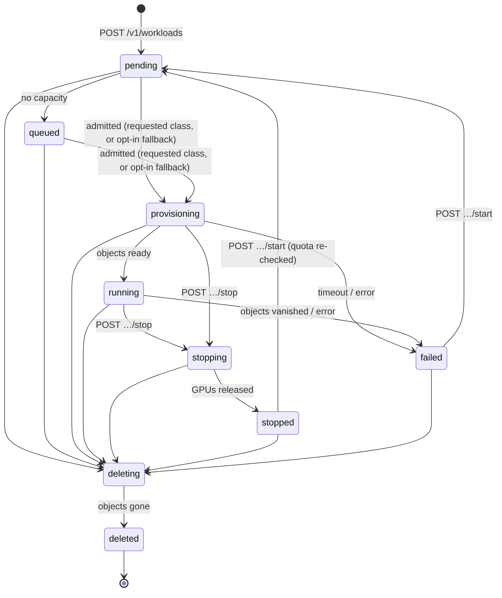

# Control plane

One Go binary (`controlplane/`), deployed as three processes plus a migration Job.

| Process | Owns | Talks to | Replicas |
|---|---|---|---|
| `tensora api` | Authn/z, validation, quota checks, recording intent | Postgres only | 2+ (stateless) |
| `tensora controller` | Admission, applying and observing cluster objects, lifecycle transitions | Postgres, its region's Kubernetes | 1 per region (ADR-0009; leader election is Phase 4) |
| `tensora metering` | Turning events into hourly usage records | Postgres | 1 |

## Sources of truth ([ADR-0008](../adr/0008-postgres-intent-kubernetes-runtime.md))

- **Postgres** owns business state: tenants, quotas, workload intent, the event history, and usage.
- **Kubernetes** owns runtime state: what is actually scheduled, ready, or broken.
- The **controller** reconciles the two. The API never calls Kubernetes. It records intent and returns immediately, so a slow or unavailable cluster never blocks or corrupts the API.

## Workload lifecycle

Source: `controlplane/internal/domain/state.go`. Keep this diagram in sync with it.

| Property | States | Used by |
|---|---|---|
| `HoldsQuota` | pending, queued, provisioning, running, stopping | API quota check |
| `HoldsCapacity` | provisioning, running, stopping, deleting | Controller admission |
| `Billable` | running | Metering |

Every transition goes through `service.Transition`, which:

1. validates the step against the table
2. compare-and-swaps the row (`UPDATE … WHERE state = $from`)
3. appends a `workload_events` row

If the API and the controller race, one side's CAS fails and that side retries on the next pass.

## Admission and queueing

- **Quota**, checked by the API at create and start: the tenant's GPUs held (`HoldsQuota`) plus the request must not exceed `quotas.max_gpus` for that GPU class. The quota row is locked `FOR UPDATE`, so concurrent creates serialize.
- **Capacity**, checked by the controller: the cluster's schedulable GPUs per class (Ready, uncordoned nodes) minus `HoldsCapacity` GPUs from Postgres. Every GPU workload goes through Tensora, so Postgres knows what is allocated without attributing pods to classes.
- **Order:** FIFO with backfill. A big request at the head doesn't block smaller ones. *Known gap:* large requests can starve, so aging is planned for Phase 3.
- **Backstop:** each tenant namespace has a `ResourceQuota` on GPU resources. It isn't the primary check, but it catches controller bugs.

## Reconcile loop

`Controller.ReconcileOnce` runs every `TENSORA_CONTROLLER_INTERVAL`:

| Step | Picks up | Does |
|---|---|---|
| admit | pending, queued | Capacity check, apply the tenant bundle and workload objects, then go to `provisioning`, or `queued` if there's no room |
| observe | provisioning, running | Ready leads to `running`. A failure, vanished objects, or exceeding `TENSORA_PROVISION_TIMEOUT` releases the GPUs and goes to `failed`. |
| park | stopping | Halt the VM, scale the notebook to 0, or delete the endpoint. Go to `stopped` once observed. |
| remove | deleting | Delete everything labeled with the workload ID, including volumes, then go to `deleted`. |

Everything is idempotent. Cluster writes are server-side applies with field manager `tensora-controller`.
The kube backend refuses any kind not in its allowlist.

## What each kind becomes in the cluster

| Kind | Objects (in `t-<slug>`) | Parked form (stopped) |
|---|---|---|
| vm | `VirtualMachine` (root disk cloned from a DataSource in `tensora-images`) | `runStrategy: Halted`, disk kept |
| notebook | `StatefulSet` + `Service`, with a 50Gi work PVC | `replicas: 0`, PVC kept |
| endpoint | `InferenceService` using the `tensora-vllm` runtime | deleted (nothing to keep) |

Every tenant gets this bundle: `Namespace` (PSA baseline), `ResourceQuota`, the `tenant-baseline`
NetworkPolicy, the `allow-from-gateway` CiliumNetworkPolicy, and a RoleBinding that lets it clone
VM images.

## API conventions

- Versioned under `/v1`. JSON only. Unknown fields are rejected.
- Errors are `{"error": {"code", "message"}}` with these codes: `invalid_request` (400), `unauthenticated` (401), `forbidden` (403), `not_found` (404), `conflict`, `quota_exceeded`, and `invalid_transition` (409).
- Async actions return **202** and the workload's current state. Clients poll.
- Another tenant's object is always **404**.
- IDs are UUIDv7. Cluster object names are `w-<hex id>` and never use the tenant-chosen name.
- *Planned (ADR-0009, ADR-0010):* create takes `region`, `fallback`, and `fallback_after`. Responses include `region`, `requested_class`, and `placed_class`. `POST` accepts an `Idempotency-Key` header, and every 503 carries `Retry-After`.

## Failure modes

| Failure | Effect | Notes |
|---|---|---|
| Controller down | New work stays `pending`; running workloads are unaffected | **Billing gap:** a workload that dies while the controller is down stays `running` and keeps being billed. Planned fix: credit from Kubernetes status history (Phase 4). |
| Postgres down | API not ready (503) and the controller pauses; the cluster keeps running | |
| Kubernetes API down | Admission and observation stop; the API still accepts requests | |
| Node lost | Its workloads go to `failed` once their objects vanish or stop being ready | VMs could live-migrate once storage is RWX (Phase 2) |
| One region down | Only that region's workloads are affected; the global API and other regions keep working | ADR-0009 |
| Requested GPU class sold out | The workload waits in `queued`, or is placed on a fallback the customer opted into | ADR-0010 |

## Regions and fallback placement

*Designed, not yet built.* Roadmap Phase 0 adds these to the data model before any real data exists.

- **Regions** ([ADR-0009](../adr/0009-regions-global-control-plane-regional-cells.md)): each workload gets an immutable `region`. One controller runs per region (`TENSORA_REGION`), touching only that region's workloads, and capacity is computed per region. The API, accounts, quotas, and billing stay global.
- **Fallback placement** ([ADR-0010](../adr/0010-fallbacks-cpu-placement-and-inference-failover.md)): workloads may carry `fallback`, an ordered list of other GPU classes and/or `cpu`, plus `fallback_after`. Admission tries the requested class first, then each fallback once `fallback_after` has passed. It records `requested_class` and `placed_class`, and the event says why. Freed GPUs go to workloads waiting for that class before CPU-fallback endpoints are promoted back to GPU.
- **Inference failover** happens per request in the regional inference gateway, not in the controller.

## Next resources (Phase 3)

- **Models:** `POST /v1/models {source: hf://…}` launches a `tensora-ml ingest` Job that validates the model and copies it to `s3://tensora-models/<tenant>/<id>`. Endpoints then reference `model_id` instead of a raw URI.
- **Access:** per-endpoint HTTPRoutes with API keys, an authenticating proxy for notebooks, and SSH exposure for VMs (see [networking.md](networking.md)).
- **Usage API:** `GET /v1/usage?from&to`, backed by `store.Usage`.
- **Operations:** Prometheus `/metrics` (queue depth, reconcile latency, transition counts) and leader election.
