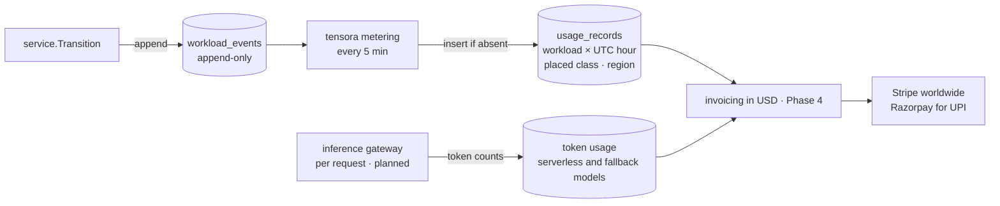

# Metering and billing

## Principle: bill allocation, not utilization ([ADR-0006](../adr/0006-bill-on-allocation.md))

A customer pays for the time a GPU is **reserved for them**, whether or not they keep it busy.
That's how every GPU cloud bills. It's also the only option that works for passthrough VMs: a
GPU bound to `vfio-pci` is invisible to the host's DCGM exporter.

## Pipeline

## Rules (as implemented in `controlplane/internal/metering`)

- **Billable state:** `running` only. Provisioning time (image pull, model download) is not billed.
- **Bill what ran, not what was asked for:** usage is priced by the class a workload was actually placed on (`placed_class`, ADR-0010), so a CPU fallback is billed at CPU prices. *Not yet in code: `usage_records.gpu_class` currently holds the requested class.*
- **Granularity:** per second, rounded down within each hour segment, stored as one row per workload per UTC hour. GPU-seconds equal `seconds × gpu_count`.
- **Closed hours only:** an hour is metered once `now − 5 min` has passed its end (the settle delay for in-flight transitions).
- **Idempotent:** rows are insert-if-absent on `(workload_id, period_start)` and never updated. Re-running metering is safe.
- **Lookback:** each pass re-examines the last 48 h. Older hours are final.
- **Immutable inputs:** `workload_events` rejects `UPDATE` and `DELETE` with a trigger.

## Phase 4: from usage to invoices

| Piece | Notes |
|---|---|
| Price book | Price per region, per class (GPU and CPU), per hour, **in USD**. Versioned with effective dates; priced from usage at invoice time. |
| Storage billing | GB-hours for persistent disks (stopped VMs and notebooks still hold storage) |
| Invoices | Monthly, tax-compliant for the customer's location: GST (India, with GSTIN for B2B), VAT (EU and UK, with reverse charge for B2B), US sales tax. Use a tax engine (for example Stripe Tax) and an accountant per jurisdiction. Sequential invoice numbers. |
| Payments | Stripe for cards worldwide; Razorpay for UPI and Indian cards. Credits and charges are in USD; a method that needs local currency (UPI) is converted at checkout. Prepaid credits suit a new provider: they avoid bad debt and allow hard spend limits. |
| Screening | Sanctions and export-control checks before an account can buy GPU time (see the product spec's legal section) |
| Spend limits | Stop or park workloads when credits run out, after warnings |
| Credits | Automatic credits for platform-caused failures (see the gap below) |

## Known gaps

- **Controller downtime:** a workload that dies while the controller is down stays `running` and is billed until the controller notices. The fix is to reconcile against Kubernetes condition timestamps and issue credits.
- **Idle detection:** for container-mode GPUs, use DCGM `DCGM_FI_DEV_GPU_UTIL` to warn customers about idle workloads. It's a courtesy and doesn't affect billing.
- **Clock skew:** event timestamps come from the controller's clock. Run chrony on every node (the base role does).
