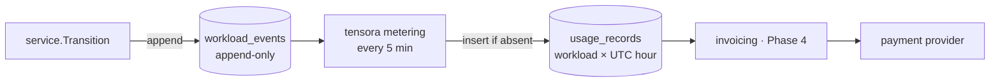

# Metering and billing

## Principle: bill allocation, not utilization ([ADR-0006](../adr/0006-bill-on-allocation.md))

A customer pays for the time a GPU is **reserved for them**, whether or not they keep it busy.
That's how every GPU cloud bills. It's also the only option that works for passthrough VMs: a
GPU bound to `vfio-pci` is invisible to the host's DCGM exporter.

## Pipeline

## Rules (as implemented in `controlplane/internal/metering`)

- **Billable state:** `running` only. Provisioning time (image pull, model download) is not billed.
- **Granularity:** per second, rounded down within each hour segment, stored as one row per workload per UTC hour. GPU-seconds equal `seconds × gpu_count`.
- **Closed hours only:** an hour is metered once `now − 5 min` has passed its end (the settle delay for in-flight transitions).
- **Idempotent:** rows are insert-if-absent on `(workload_id, period_start)` and never updated. Re-running metering is safe.
- **Lookback:** each pass re-examines the last 48 h. Older hours are final.
- **Immutable inputs:** `workload_events` rejects `UPDATE` and `DELETE` with a trigger.

## Phase 4: from usage to invoices

| Piece | Notes |
|---|---|
| Price book | Price per GPU class per hour in INR, versioned with effective dates; priced from usage at invoice time |
| Storage billing | GB-hours for persistent disks (stopped VMs and notebooks still hold storage) |
| Invoices | Monthly. GST at the applicable rate on the service (18% for most cloud services; confirm with a CA). GSTIN for B2B customers. Sequential invoice numbers. |
| Payments | Razorpay (India-first, UPI and cards) or Stripe India. Prepaid credits suit a new provider: they avoid bad debt and allow hard spend limits. |
| Spend limits | Stop or park workloads when credits run out, after warnings |
| Credits | Automatic credits for platform-caused failures (see the gap below) |

## Known gaps

- **Controller downtime:** a workload that dies while the controller is down stays `running` and is billed until the controller notices. The fix is to reconcile against Kubernetes condition timestamps and issue credits.
- **Idle detection:** for container-mode GPUs, use DCGM `DCGM_FI_DEV_GPU_UTIL` to warn customers about idle workloads. It's a courtesy and doesn't affect billing.
- **Clock skew:** event timestamps come from the controller's clock. Run chrony on every node (the base role does).
