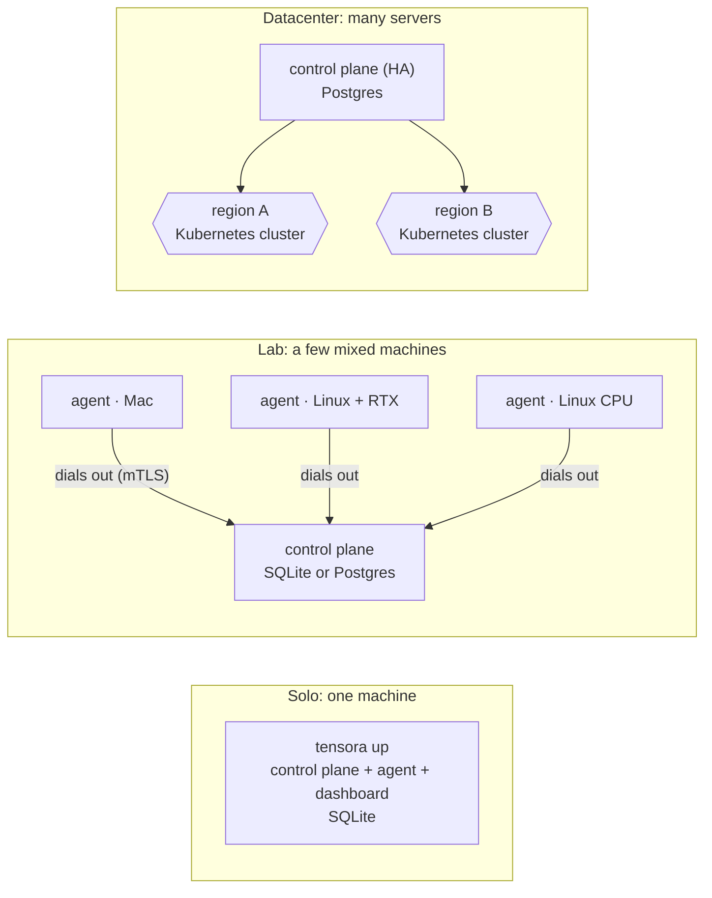
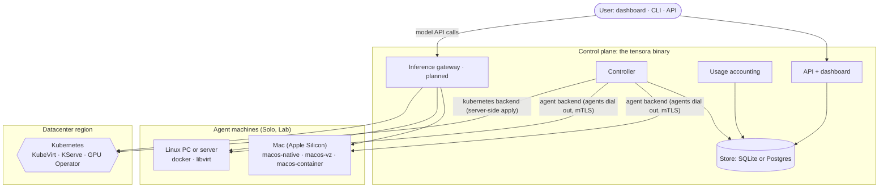

# Architecture overview

Tensora is a free, self-hosted GPU cloud ([ADR-0011](../adr/0011-free-for-everyone.md)). People install it
on machines they have, from one Mac to a datacenter, and launch these workloads on them:

| Workload | What the user gets | On a Mac | On Linux + NVIDIA | In a datacenter |
|---|---|---|---|---|
| **GPU VM** | A full VM with root access over SSH | macOS VM with Metal (Virtualization framework) | KVM VM with whole-GPU passthrough (libvirt) | KubeVirt VM with passthrough |
| **Notebook** | JupyterLab with a persistent workspace | Native Jupyter with PyTorch MPS and MLX | Container with CUDA | StatefulSet in a Kata sandbox |
| **Model endpoint** | An OpenAI-compatible API | MLX or llama.cpp on Metal | vLLM or llama.cpp | KServe with vLLM |
| **CPU instance** | A VM or container without a GPU, and the fallback when GPUs are busy | ✓ | ✓ | ✓ |

## Design assumptions

| Assumption | Consequence |
|---|---|
| **Free for everyone** ([ADR-0011](../adr/0011-free-for-everyone.md)) | No billing code anywhere. Usage accounting exists for quotas, fair share, and reports only. |
| **Runs on users' own machines**, Linux and Apple Silicon Macs, from one to thousands ([ADR-0012](../adr/0012-deployment-profiles.md), [ADR-0013](../adr/0013-node-agent-and-apple-silicon.md)) | Three profiles; a node agent with OS-specific drivers; Kubernetes only in the Datacenter profile |
| **The person using a machine may not be its owner** ([ADR-0014](../adr/0014-sharing-idle-compute.md)) | Trust levels and an isolation matrix per driver; host protections; honesty about what a host can see |
| **Some deployments span locations** ([ADR-0009](../adr/0009-regions-global-control-plane-regional-cells.md)) | Regions; a workload's data stays in its region. Solo has one implicit region, `local`. |
| **The GPU you want is often busy or missing** ([ADR-0010](../adr/0010-fallbacks-cpu-placement-and-inference-failover.md)) | Opt-in fallbacks to another GPU, CPU, or another machine |

## Profiles



One binary (`tensora`) provides the control plane, the agent, and the dashboard in every profile.
Moving up a profile is a backup and restore (`tensora backup`, `tensora restore`), not a rebuild.

## Components

| Layer | Solo and Lab | Datacenter | Where |
|---|---|---|---|
| Hardware | Your Macs, PCs, and servers | GPU servers with BMC, NVMe, and 25 GbE | [hardware/](../hardware/bill-of-materials.md) |
| OS and virtualization | macOS (Virtualization framework); Linux (KVM) | Ubuntu 24.04, KVM through KubeVirt | `infra/` (Datacenter) |
| GPU access | Metal on Macs; NVIDIA driver and container toolkit on Linux | NVIDIA GPU Operator | `deploy/platform/gpu-operator` |
| Runtime | **Node agent** (built; in-process in Solo, ADR-0016) with drivers: `macos-native`, `macos-vz`, `macos-container`, `docker`, `libvirt` (planned) | k3s, KubeVirt, CDI, KServe ([ADR-0001](../adr/0001-kubernetes-kubevirt-gpu-operator.md)) | `controlplane/`, `deploy/` |
| Model serving | MLX, llama.cpp, vLLM | KServe + `tensora-vllm` (CPU variant planned) | `deploy/charts/cluster-config` |
| Store | SQLite, or Postgres for larger Labs | Postgres HA | `controlplane/internal/store` |
| Networking | Agents dial out over mTLS; a relay for remote access | Cilium, MetalLB, Gateway API, WireGuard ([ADR-0007](../adr/0007-gateway-api-on-cilium.md)) | [networking.md](networking.md) |
| Storage | Local disk on each machine | Longhorn, then Ceph ([ADR-0005](../adr/0005-storage-longhorn-then-ceph.md)) | [storage.md](storage.md) |
| Identity | Local accounts and API tokens | Keycloak, or the company's IdP (OIDC/SAML) | `controlplane/internal/auth` |
| Observability | Built into the dashboard | Prometheus, DCGM, Loki, Grafana | [observability.md](observability.md) |
| Logs and transparency | Workload timeline, complete export, request IDs; CLI and dashboard (built). Output logs from agents (planned). | Same, with output logs through Loki (planned) | [logs-and-transparency.md](logs-and-transparency.md) |
| Admission and placement | Quotas, capacity, region, and opt-in fallbacks ([ADR-0010](../adr/0010-fallbacks-cpu-placement-and-inference-failover.md)); sharing rules ([ADR-0014](../adr/0014-sharing-idle-compute.md)) | Same | [control-plane.md](control-plane.md) |
| Inference gateway | Built into the control plane (planned) | Regional gateway (planned) | [ADR-0010](../adr/0010-fallbacks-cpu-placement-and-inference-failover.md) |
| Our code | `tensora` (Go): API, controller, agent, usage accounting, dashboard. `tensora-ml` (Python). | Same | `controlplane/`, `ml/`, `web/` |

## System diagram



Today's code implements the control plane with its SQLite and Postgres stores, the fake backend, and the
Kubernetes backend. The agent, its drivers, the gateway, regions, and fallbacks are designed but not built yet
([roadmap](../roadmap.md)).

## Request flow: a model endpoint on a Mac (Solo)

```mermaid
sequenceDiagram
  actor U as User
  participant T as tensora up (API, controller, agent)
  participant S as SQLite
  participant D as macos-native driver
  participant M as Model server (llama.cpp or MLX)
  U->>T: launch endpoint {model: hf://…, accelerator: apple, fallback: [cpu]}
  T->>S: check quota, record workload (pending) + event
  T->>D: start endpoint on this Mac
  D->>D: download model, run tensora-ml validate (GGUF or safetensors only)
  D->>M: start server in a sandbox, Metal enabled, memory capped
  M-->>D: healthy
  T->>S: pending → running (+event); usage accounting starts
  T-->>U: http://localhost:…/v1 (OpenAI-compatible)
  U->>M: POST /v1/chat/completions
```

## Request flow: a model endpoint in a datacenter

```mermaid
sequenceDiagram
  actor U as User
  participant A as API
  participant DB as Postgres
  participant C as Controller (region)
  participant K as Kubernetes (region)
  participant G as Inference gateway (region)
  U->>A: POST /v1/workloads {kind: endpoint, region, gpu_class, fallback: [cpu]}
  A->>DB: lock quota row, check GPUs held, insert workload (pending, region, gpu_class) + event
  A-->>U: 201 {state: pending}
  loop every 5s
    C->>DB: pending/queued workloads in my region, GPUs allocated
    C->>K: capacity per class (GPU and CPU)
    alt requested class has room
      C->>K: apply tenant bundle + InferenceService on GPU
    else busy past fallback_after (opted in)
      C->>K: apply tenant bundle + InferenceService on CPU
    end
    C->>DB: placed_class recorded, pending → provisioning (+event), one transaction
    C->>K: observe InferenceService Ready?
    C->>DB: provisioning → running (+event); usage accounting starts
  end
  U->>G: POST /v1/chat/completions (API key)
  G-->>U: answer + X-Tensora-Served-By / X-Tensora-Fallback headers
```

## Request flow: a GPU VM in a datacenter

```mermaid
sequenceDiagram
  actor U as User
  participant A as API
  participant DB as Postgres
  participant C as Controller (region)
  participant K as Kubernetes + KubeVirt (region)
  participant N as GPU node (vm-passthrough mode)
  U->>A: POST /v1/workloads {kind: vm, image_id, gpu_class, gpu_count, ssh_public_key}
  A->>DB: check quota, insert workload (pending) + event
  A-->>U: 201 {state: pending}
  C->>K: apply tenant bundle + VirtualMachine (runStrategy: Always)
  K->>K: CDI clones the root disk from the DataSource in tensora-images
  K->>N: schedule virt-launcher; whole GPUs passed through via VFIO
  N-->>K: VM boots; cloud-init installs the user's SSH key
  C->>K: observe VM printableStatus = Running
  C->>DB: provisioning → running (+event); usage accounting starts
  U->>N: ssh into the VM, run nvidia-smi
  U->>A: POST /v1/workloads/{id}/stop
  C->>K: runStrategy: Halted (disk kept, GPUs freed)
  C->>DB: stopping → stopped (+event); usage accounting stops
```

On a Mac, a GPU VM is a macOS guest started by the `macos-vz` driver, with Metal through paravirtualized graphics.
On a Linux machine in a Lab, the `libvirt` driver does the same job as KubeVirt.

The code for the datacenter VM flow:

- `controlplane/internal/cluster/manifests/workloads.go` (`virtualMachine`)
- `cluster/kube/kube.go` (`observeVM`)
- the controller's park step

## Deliberately out of scope (for now)

- Any pricing, payments, or paid features (ADR-0011)
- Intel Macs; Windows before M5
- Workloads that span machines or regions while running, or move between them
- User access to the Kubernetes API
- Multi-node distributed training (InfiniBand or RoCE)
