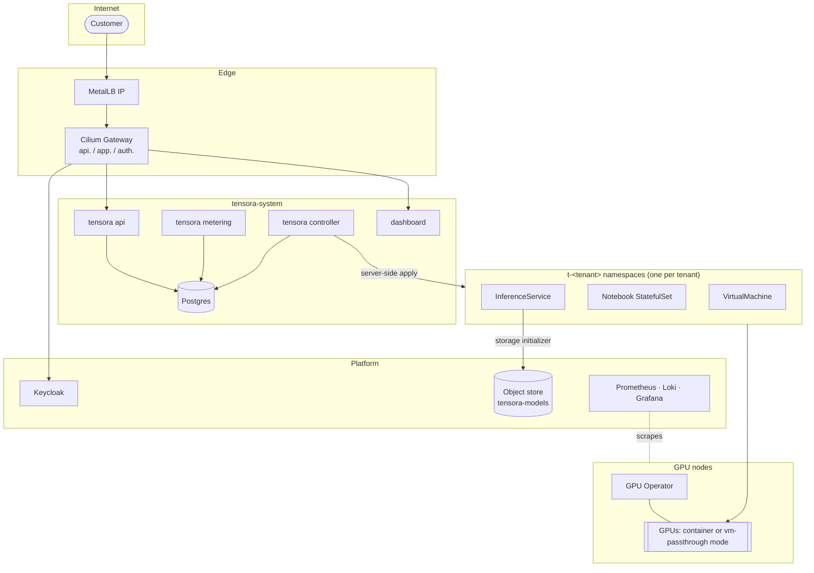
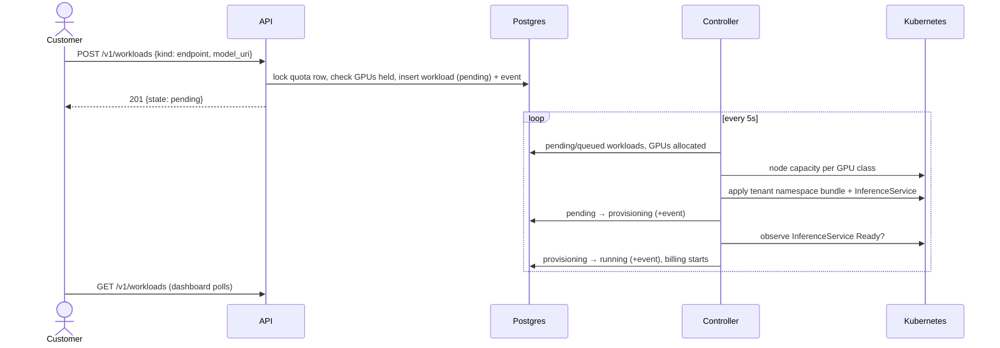

# Architecture overview

Tensora is a small GPU cloud. Customers launch three kinds of workload on GPUs we own:

| Kind | What the customer gets | Built on |
|---|---|---|
| **VM** | A full Linux VM with whole GPUs passed through, accessed over SSH | KubeVirt + VFIO |
| **Notebook** | JupyterLab with a GPU and a persistent work directory | StatefulSet in a Kata sandbox |
| **Endpoint** | An OpenAI-compatible API serving a safetensors model | KServe (RawDeployment) + vLLM |

We assemble proven open-source infrastructure and write the product layer: the control plane (Go),
the ML tooling (Python), and the dashboard (TypeScript).

## Design assumptions

These assumptions shape most decisions. **Confirm or correct them.** They are tracked in [roadmap.md](../roadmap.md#open-decisions).

| Assumption | Consequence | If it's wrong |
|---|---|---|
| Customers are **external and untrusted** | VMs or Kata for their code, strict network policy, metering-grade billing, abuse handling | If it's internal-only, a `trusted` tier with runc containers and even time-slicing becomes acceptable, and billing becomes showback |
| We start with **one GPU node** and grow to about 3–10 | k3s, Longhorn first, Ceph later; no multi-node training fabric yet | At 20+ nodes from day one, start with Ceph and consider full Kubernetes with HA from the beginning |
| We operate **in India** | Power and cooling planning, INR billing with GST, the DPDP Act for personal data | Change the billing and compliance sections |
| The workload mix is VMs, notebooks, and LLM inference | Whole-GPU allocation; MIG later for small inference | If training-heavy, prioritize 8-GPU NVLink nodes and an InfiniBand or RoCE fabric |

## Layers and components

| # | Layer | Choice | Phase | Where |
|---|---|---|---|---|
| 1 | Hardware | Datacenter GPUs (L40S, A100, H100) in servers with BMC, NVMe, and 25 GbE; UPS | 1 | [hardware/](../hardware/bill-of-materials.md) |
| 2 | OS and virtualization | Ubuntu 24.04, KVM via KubeVirt, IOMMU/VFIO | 1 | `infra/ansible` (base, iommu) |
| 2 | GPU management | NVIDIA GPU Operator: driver, toolkit, device plugins, vfio-manager, MIG manager, DCGM | 1 | `deploy/platform/gpu-operator` |
| 3 | Orchestration | k3s with embedded etcd, KubeVirt + CDI ([ADR-0001](../adr/0001-kubernetes-kubevirt-gpu-operator.md), [ADR-0002](../adr/0002-k3s-single-node-first.md)) | 1 | `infra/ansible/roles/k3s`, `deploy/platform/kubevirt` |
| 4 | Model serving | KServe RawDeployment + the pinned `tensora-vllm` runtime; MLflow later | 1 / 3 | `deploy/platform/kserve`, `cluster-config` |
| 5 | Storage | Longhorn and S3 (choice open) → Rook-Ceph (RBD, RGW, CephFS) ([ADR-0005](../adr/0005-storage-longhorn-then-ceph.md)) | 1 → 2 | [storage.md](storage.md) |
| 6 | Networking | Cilium (CNI, kube-proxy replacement, policy, Gateway API), MetalLB, cert-manager, WireGuard ([ADR-0007](../adr/0007-gateway-api-on-cilium.md)) | 1 | [networking.md](networking.md) |
| 7 | Product | Tensora API, controller, and metering (Go); dashboard (TS); ML tooling (Python); Keycloak ([ADR-0003](../adr/0003-language-split.md)) | 3 | `controlplane/`, `web/`, `ml/` |
| 7 | Queueing | Tensora admission (quota and capacity); Kueue later for batch jobs | 3 / 4 | [control-plane.md](control-plane.md) |
| 8 | Observability | kube-prometheus-stack, DCGM exporter, Loki + Alloy | 2 | [observability.md](observability.md) |
| 8 | Isolation | VMs or Kata, default-deny networking, no tenant Kubernetes API access ([ADR-0004](../adr/0004-untrusted-code-in-vms-or-kata.md)) | 1–3 | [tenancy-and-isolation.md](tenancy-and-isolation.md) |

## System diagram

## Request flow: launching an endpoint

## Deliberately out of scope (for now)

- Multi-node distributed training (InfiniBand/RoCE, NCCL tuning, gang scheduling)
- Customer access to the Kubernetes API, and bring-your-own container images
- Spot or preemptible capacity, reservations, and multiple regions
- Scale-to-zero endpoints (this needs Knative serverless mode)
