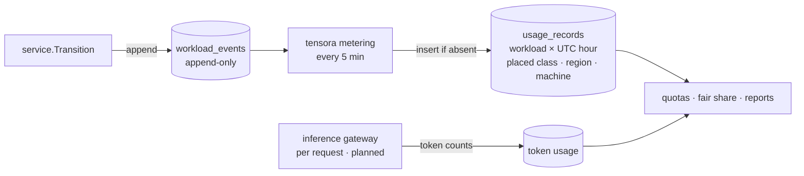

# Usage accounting

Tensora is free ([ADR-0011](../adr/0011-free-for-everyone.md)). Usage accounting records **who used how
much compute, where, and for how long**, and that's all. It's never converted into money.

## What it's for

| Use | Example |
|---|---|
| **Quotas** | A student may hold at most 1 GPU at a time; a team gets 8 |
| **Fair share** | On a busy Lab or community pool, people who've used less get admitted first (planned) |
| **Reports** | "This class used 340 GPU-hours this month"; per-user and per-team usage pages (planned) |
| **Recognizing hosts** | Owners who share machines see the hours they've contributed ([ADR-0014](../adr/0014-sharing-idle-compute.md)) |
| **Capacity planning** | Which classes are always queued, and how often fallbacks kick in |

## Principle: account for allocation, not utilization

Usage is the time a resource is **reserved** for a workload (a `Metered` state), whether or not the
workload keeps it busy. The mechanism comes from ADR-0006.

- A reserved GPU is unavailable to everyone else, so allocation is what matters for fairness.
- Passthrough GPUs and macOS guests are invisible to host metrics, so utilization can't be measured reliably anyway.
- Utilization metrics (DCGM, macOS IOKit) are used for dashboards and idle hints only.

## Pipeline

## Rules (as implemented in `controlplane/internal/metering`)

- **Metered state:** `running` only (`State.Metered`). Time spent provisioning, downloading, or booting isn't counted.
- **Granularity:** per second, rounded down within each hour segment, stored as one row per workload per UTC hour. GPU-seconds equal `seconds × gpu_count`.
- **Closed hours only:** an hour is recorded once `now − 5 min` has passed its end, to let in-flight transitions settle.
- **Idempotent:** rows are insert-if-absent on `(workload_id, period_start)` and never updated, so re-running is safe.
- **Lookback:** each pass re-examines the last 48 h. Older hours are final.
- **Immutable inputs:** `workload_events` rejects `UPDATE` and `DELETE` with a trigger.
- **Account for what ran** (ADR-0010, rule 9): each usage record holds the class the workload actually ran on (its `placed_class`, stored in `usage_records.gpu_class`), its region, and its machine, so a CPU fallback counts as CPU time. A workload can't reach `running` before it's placed. *Known gap (Phase 2):* metering reads the workload's current placement, so if a restart re-places it on another class, hours not yet recorded are accounted on the new one. The fix is to take each interval's class from its admission event.

## Known gaps

- **Controller downtime:** a workload that dies while the controller is down stays `running` until it's noticed. The fix is to reconcile against runtime condition timestamps.
- **Clock skew:** timestamps come from the controller's clock. The Datacenter profile runs chrony on every node (the base Ansible role does), and agents report their clock offset (planned).
- **Fair-share policy:** the weighting (decay window, per-team shares) is still to be designed (Phase 4).
